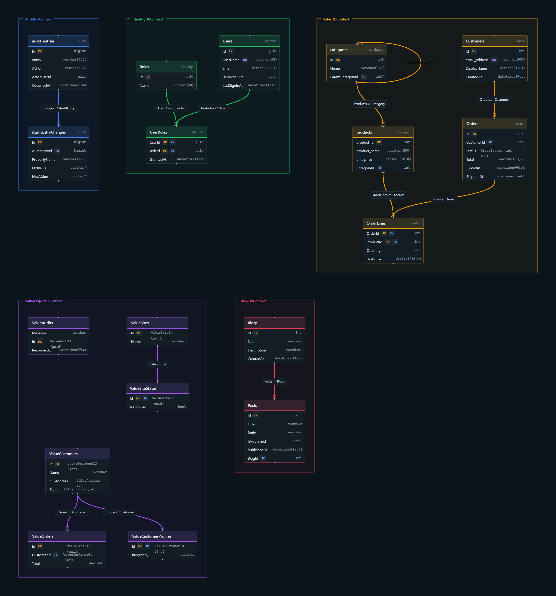

# Entity Framework Core ER Diagrams

`AspireC4.Hosting.EntityFrameworkCore` adds a **second, optional diagram** to AspireC4: a live ER diagram
of your Entity Framework Core `DbContext` types, hosted beside the architecture diagram and linked from
it.

It is **additive** — `AddAspireC4()` is always the base, and `WithEntityFrameworkDiagram()` adds the ER
diagram to the builder it returns. You can run the architecture diagram on its own and never install this
package; there is no way to run the ER diagram without the architecture diagram.



## Packages and target frameworks

| Package | Target framework | Add to | Why |
| --- | --- | --- | --- |
| `AspireC4.Hosting` | `net10.0`, `net11.0` | the AppHost | the architecture diagram this one hangs off. Required first |
| `AspireC4.Hosting.EntityFrameworkCore` | `net10.0`, `net11.0` | the AppHost | the ER diagram itself |
| `AspireC4.EntityFrameworkCore` | `netstandard2.0` (analyzer-only) | a project **you own** that declares a `DbContext` | captures fluent `OnModelCreating` configuration |
| `AspireC4.EntityFrameworkCore.ModelDump` | `net10.0` (build-time tool) | the project that owns the EF Core **provider** and a design-time factory | the authoritative model, composite foreign keys included |

Both libraries ship `net10.0` and `net11.0` assets, so an AppHost on either runtime resolves one. The
analyzer package is `netstandard2.0` and ships only under `analyzers/dotnet/cs/`: it adds no runtime
assembly, so it works whatever framework the owning project targets — but it runs inside the compiler,
so the owning project must be built with the .NET 11 SDK. The dump tool is `net10.0` and runs as
`dotnet <tool>.dll` from an MSBuild `Exec`, rolling forward to the latest installed major runtime, so the
.NET 11 SDK's runtime is enough and a project that builds `net11.0` can be loaded.
[Requirements](Requirements.md) has the detail for both, including what happens when either cannot run.

## Enabling it

### 1. Add the package to the AppHost

```bash
dotnet add package AspireC4.Hosting.EntityFrameworkCore
```

### 2. Register the projects that own your `DbContext` types

The diagram is built from **Aspire project resources**. Every project added with
`AddProject<Projects.X>(...)` is scanned for `DbContext` types, including contexts that live in class
libraries the project references. A project that is only a `<ProjectReference>`, or that runs as a
container or executable, is not scanned.

### 3. Call `WithEntityFrameworkDiagram()`

```csharp
var builder = DistributedApplication.CreateBuilder(args);

builder.AddAspireC4()
       .WithEntityFrameworkDiagram();

builder.AddProject<Projects.Orders_Api>("orders-api");

builder.Build().Run();
```

Run the AppHost. The dashboard shows both diagrams under a shared `aspirec4` parent row, each project that
contributed a context gets an **ER Diagram** link, and the project's element in the architecture diagram
gets one too. Output is written to `./.aspirec4/erd/` beside the AppHost.

The model is read from each project's **build output** (`bin/`), so a project must have been built before
the AppHost starts. Building the AppHost builds its referenced projects, so normally you do not need to do
anything.

## How the model is read

Each context is recovered from the best source available, and the diagram records which one was used:

| Source | When | Fidelity |
| --- | --- | --- |
| **Dump** | the project, or one it references, references `AspireC4.EntityFrameworkCore.ModelDump` | `Full` — the real EF model, value converters and composite foreign keys included |
| **Descriptor** | the project references the analyzer-only `AspireC4.EntityFrameworkCore` package | `Full` — includes fluent `OnModelCreating` configuration |
| **Metadata** | otherwise | `Approximate` — conventions and data annotations only |

The metadata reader opens the built assembly with a reflection-only load context, so no code runs. It
cannot see `OnModelCreating` — a method body is absent from metadata — so a project without a package
still appears, but fluent renames, default schemas and `Ignore` calls do not. A shared or third-party
assembly you cannot instrument contributes at this fidelity.

Every context carries its fidelity in the diagram, so an approximate model is never mistaken for a
complete one. When the same context reaches the diagram through several projects, the higher-fidelity
description wins.

### The build-time dump (opt-in)

Reference `AspireC4.EntityFrameworkCore.ModelDump` from the project that owns the EF Core provider; that
reference **is** the opt-in. After every build the tool builds each context's real `IModel` through its
`IDesignTimeDbContextFactory<T>` and writes the diagram contract to `obj/aspirec4/ef/`. That directory is
never copied to `bin/` or `publish/` and is gitignored, so the dump has no deployment footprint. The
AppHost reads it from that project and every project it references, and falls back when it is missing or
older than the built assembly.

Set `<AspireC4EfModelDumpConnectionString>` when the design-time factory needs one to build its options —
the model is never opened, so any syntactically valid value works. A dump failure never fails the build.

## Value objects, enums and unions

A column declared with a domain type shows it beside the real database type — `AssetId (guid)`,
`ActorType (int, enum)` — as `DomainTypeDisplay` chooses. This page owns the rules for what is recognised.

| Declared as | Shown as |
| --- | --- |
| Purview `[Scalar<T>]`, `[Scalar(typeof(T))]`, `[Scalar("Amount")]`, `IScalarValueObject<TSelf, TValue>`, or any non-generic struct with a public `Value` | a **scalar value object**: one column of the wrapped type. A struct or a class |
| `Nullable<T>` of any of those | the same value object, nullable |
| Purview `[ValueObject]` (its `EFMapping` defaults to `ComplexType`), EF's `[ComplexType]`, `ComplexProperty(...)`, `[Owned]` or `OwnsOne(...)` sharing the owner's table | a **complex value object**: `{Property}_{Member}` columns on the owner's table, folded under the property in the viewer |
| `[ValueObject(EFMapping = Json)]`, `OwnsOne(...).ToJson()`, a complex collection | a complex value object in **one `json` column** |
| `List<string>`, `Guid[]`, `List<AssetId>` | **one `json` column**; a collection of value objects or enums shows as `AssetId[]` |
| an enum | its underlying integral type (`tinyint` for a `byte` enum) marked `enum`, or `varchar` when converted to a string |
| a C# union — `union`, or a struct marked `[Union]` / implementing `IUnion` | marked **`union`**. EF needs a value converter to store one, so the database type is what the converter produces |
| `OwnsMany(...)`, or an `[Owned]` type in a collection | a table of its own, with a foreign key to its owner |

A member of a complex value object that is itself a scalar value object or an enum keeps its own type,
and still records which property it belongs to, so the viewer groups it correctly. A union is never taken
for a scalar value object, although its `Value` accessor has the same shape.

### Relationships through value objects

A foreign key typed with a value object resolves like any other, from **either end**:

- a reference navigation on the dependent (`Order.Customer`), with the key found by `[ForeignKey]`,
  `{Navigation}Id` or `{Principal}Id`;
- or only a collection on the principal (`Customer.Orders`). EF then matches the key by name
  (`{Principal}{Key}`, `{Principal}Id`); when the dependent declares none, EF adds a shadow foreign key,
  and the diagram shows that column — nullable, typed like the key it references.

A single-column foreign key into a composite key is paired with the key column of its own type. A
collection answered by a collection on the other side is a many-to-many through a join table EF owns.

### What each source can see

The analyzer descriptor and the metadata reader apply the same rules to the declared types, so they
agree; the build-time dump reads the real model and sees configuration neither can:

| | Dump | Descriptor | Metadata |
| --- | --- | --- | --- |
| attribute- and shape-based value objects, unions, collections | yes | yes | yes |
| `ComplexProperty`, `OwnsOne`, `OwnsMany`, `ToJson` configured fluently | yes | no | no |
| an enum's `HasConversion<string>()` | `varchar` | its integral type | its integral type |
| an explicit column type | `HasColumnType`, `[Column(TypeName)]` | both | `[Column(TypeName)]` |
| relationships configured only with `HasOne`/`HasForeignKey` | yes | no | no |
## Choosing which contexts appear

By default every project resource is scanned. To narrow that down:

```csharp
builder.AddAspireC4()
       .WithEntityFrameworkDiagram(configure: options => options
           .WithProjectOptInOnly()                         // only projects marked below
           .WithExcludedContexts("IdentityDbContext"));    // short or fully-qualified name

builder.AddProject<Projects.Orders_Api>("orders-api")
       .WithEntityFrameworkModel(options => options
           .WithIncludedContexts("OrdersDbContext"));      // per-project filter

builder.AddProject<Projects.Billing_Api>("billing-api")
       .WithEntityFrameworkModel(label: "Billing");        // label the project's group
```

Names match case-insensitively and an exclusion always wins over an inclusion. This is how a context
shared by several projects — an `IdentityDbContext` in a common library nobody owns — is kept out without
editing that library.

## Renderers

| `Renderer` | Output | Use it for |
| --- | --- | --- |
| `Interactive` *(default)* | `.json` + browser viewer | exploring the schema: search, column-level edges, crow's-foot cardinality, PNG/SVG export |
| `Mermaid` | `.mmd` + preview | pasting into GitHub, Azure DevOps or a wiki |
| `Dbml` | `.dbml` | dbdiagram.io and other DBML tooling |
| `D2` | `.d2` + a live d2 sidecar | a live d2 view |

Every text format is a lossy projection of the model; only the interactive renderer consumes the
descriptor directly, which is why it is the default.

The interactive and Mermaid viewers are static files served by a small `nginx` sidecar, so the dashboard
has a real URL to link to. Set `UseViewerServer = false` where there is no container runtime: the diagram
is still generated and the dashboard offers a command that opens it locally.

## Configuration

Set options in the `configure` callback or in the `AspireC4:EntityFramework` configuration section.

| Property | Default | Description |
| --- | --- | --- |
| `Renderer` | `Interactive` | `Interactive`, `Mermaid`, `Dbml` or `D2` |
| `Title` | `null` | title shown in the diagram |
| `DiscoverAllProjects` | `true` | scan every project resource. `WithProjectOptInOnly()` restricts it |
| `IncludedContexts` / `ExcludedContexts` | empty | `WithIncludedContexts(...)` / `WithExcludedContexts(...)` |
| `OutputDirectory` | `"./.aspirec4/erd/"` | where generated files are written, relative to the AppHost |
| `FileName` | `"schema.gen"` | generated file name without extension |
| `DomainTypeDisplay` | `DomainTypeFirst` | how a value object, enum or union shows beside the store type: `AssetId (guid)`, `ActorType (int, enum)`. d2 has no annotation slot, so with `DomainTypeOnly` its tables show the domain type alone; the other renderers keep the database type as a note or tooltip |
| `ShowNullability` | `true` | mark nullable columns with `?` |
| `GroupBySchema` / `GroupByContext` | `true` | group tables by database schema, and by `DbContext` when there are several |
| `UseSubgraphs` | `true` | Mermaid only: one `subgraph` per `DbContext` (Mermaid 11.17+) |
| `LayoutEngine` | `Elk` | D2 only: `Dagre`, `Elk` or `Tala` |
| `UseViewerServer` | `true` | serve the viewer from a container |
| `HideFromDashboard` | `false` | hide the diagram's sidecar from the dashboard |
| `ExportImages` | `true` | write `schema.svg` / `schema.png` to `./.aspirec4/images/` when the model changes |
| `ImageFormats` | `{Svg, Png}` | `WithImageExport(...)`, or `WithoutImageExport()` to turn export off |
| `UseViewerFidelityExport` | `false` | render images through the interactive viewer in a headless browser. Pulls a ~3.7 GB Playwright image |
| `D2Command` | `null` | a local `d2` binary for image export, instead of the container |
| `ContainerRuntimeCommand` | `"docker"` | set to `podman` where Aspire uses Podman |
| `GenerateGitIgnoreFile` | `true` | write a `.gitignore` naming the generated files; `WithoutGitIgnoreFileGeneration()` turns it off. See [Source control](Generated-Output.md#source-control) |

> [!IMPORTANT]
> Set `OutputDirectory` in the callback rather than in configuration. The sidecar's bind mount is fixed
> when the AppHost builder runs, so a value from configuration changes where files are written but not
> what the sidecar serves.

### Without a container runtime

```csharp
// Generate the files without starting a viewer container, and render images with a local d2
builder.AddAspireC4()
       .WithEntityFrameworkDiagram(configure: options =>
       {
           options.UseViewerServer = false;   // the dashboard offers an "open locally" command instead
           options.D2Command = "d2";          // or call options.WithoutImageExport()
       });

// Or, with the D2 renderer, replace the d2 container with a local binary
builder.AddAspireC4()
       .WithEntityFrameworkDiagram(configure: options => options.Renderer = ErdRenderer.D2)
       .WithLocalD2CLI();                     // must come after WithEntityFrameworkDiagram
```

d2 is a Go binary; install it with scoop, Homebrew, `install.sh` or `go install`.

## Exporting images

Both diagrams export to **one folder**, `./.aspirec4/images/`, so there is a single place to look. The ER
diagram writes `schema.svg` and `schema.png` (renamed by `FileName`) whenever the model changes, and never
on `aspire publish`.

The ER export is fully cached: it is derived from the EF model alone, so restarting the AppHost over an
unchanged schema renders nothing. A stamp file beside the images records what they were rendered from.

`UseViewerFidelityExport` makes the file identical to the viewer's own **Save as SVG / PNG** support by
loading the generated viewer in a headless browser and calling the same function the toolbar uses. It is
off by default because it pulls `mcr.microsoft.com/playwright` (around 3.7 GB) and takes seconds rather
than milliseconds. It applies only to the `Interactive` renderer.

Prefer SVG for a large schema — a raster of the whole thing is unreadable at any sensible size. The
images folder is also the place to take a screenshot from: the one on this page is a viewer capture of the
sample AppHost's schema, kept in `docs/images/screenshots/`.

## Dashboard

With only the architecture diagram registered, `aspirec4` is a single flat row. Registering the ER diagram
nests both under a shared parent:

```text
aspirec4                 # parent row, added only when there is more than one diagram
├── aspirec4-likec4      # the architecture diagram, renamed as it is nested
└── aspirec4-er          # the ER diagram, with its own sidecar nested beneath it
```

The ER diagram row carries an **Images** property with the resolved export path and an **Open Diagram
Images** command that opens the folder. Grouping and the `-likec4` rename arrived in 13.6;
`WithLegacyLayout()` keeps the flat `aspirec4` / `aspirec4-er` pair — see [Migration](Migration.md).

## Troubleshooting

- **No diagram content.** Check the project is added with `AddProject<Projects.X>` and has been built.
  The `aspirec4-er` resource's log names each project where no model was found.
- **Tables are missing their fluent configuration.** The context was read from metadata
  (`Approximate`). Add `AspireC4.EntityFrameworkCore` to the project that declares it.
- **A composite or fluent-only relationship is not drawn.** Only the model dump sees these. Add
  `AspireC4.EntityFrameworkCore.ModelDump` to the project with the provider and a design-time factory.
- **Fluently configured complex and owned types are missing or show as tables.** `ComplexProperty`,
  `OwnsOne` and `ToJson` are method calls, invisible to the static sources; mark the type `[ValueObject]`,
  `[ComplexType]` or `[Owned]`, or add the model dump.
- **Not captured from any source:** inheritance mapping, delete behaviour, sequences, check constraints.
  Relationships across `DbContext` boundaries are never drawn.
- **The runner, not the product.** Running `AspireC4.IntegrationTests` from an IDE test runner fails
  Aspire's project-resource start-up, which surfaces as an empty ER model. Use `just test-integration`.

## Next pages

- [Getting Started](Getting-Started.md)
- [Generated Output](Generated-Output.md)
- [Dashboard Integration](Dashboard-Integration.md)
- [Configuration](Configuration.md)

