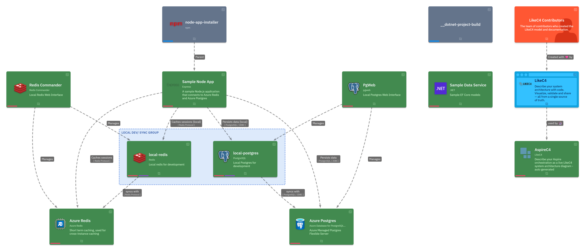
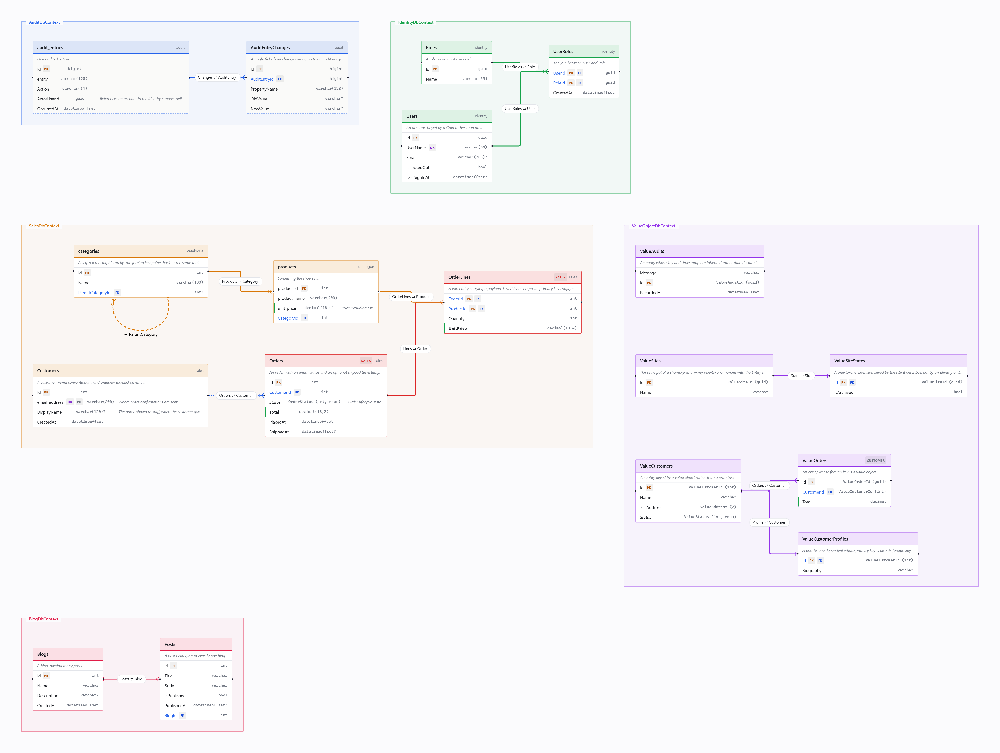

# AspireC4 Wiki

This wiki is the project documentation hub for `AspireC4.Hosting`, an [Aspire](https://learn.microsoft.com/en-us/dotnet/aspire/) extension library that generates live [LikeC4](https://likec4.dev) architecture diagrams from the Aspire resource graph.

AspireC4 turns your distributed application into a living architecture diagram. On startup it builds a `.c4` model file from the Aspire resource graph, starts the official LikeC4 server as a sidecar, and keeps the diagram refreshed as resources start, stop, and change state at runtime.

> [!TIP]
> **Upgrading from 13.5?** 13.6 moved all generated output beneath `./.aspirec4/` and changed the
> dashboard names when a second diagram is registered. If you need the pre-13.6 layout unchanged, turn
> on **legacy mode** with `WithLegacyLayout()` or `"AspireC4": { "UseLegacyLayout": true }`.
> The [Migration Guide](Migration.md) has the full before/after and the opt-out details.

## Start here

The pages are layered: each one owns its topic, and a page that only needs to mention a topic links to
its owner instead of restating it.

| Section | Pages |
| --- | --- |
| **Using AspireC4** | [Requirements](Requirements.md) — the SDK, runtime, Aspire and container requirements, and why · [Getting Started](Getting-Started.md) — install and first run · [Migration Guide](Migration.md) — breaking changes and how to upgrade |
| **AppHost languages** | [Overview](apphosts/README.md) — C#, TypeScript, Go and Python AppHosts: one API, and what differs · [TypeScript](apphosts/TypeScript.md) · [Go](apphosts/Go.md) · [Python](apphosts/Python.md) |
| **Diagrams** | [Generated Output](Generated-Output.md) — what is written where, and extending the model · [Dashboard Integration](Dashboard-Integration.md) · [Entity Framework Core ER Diagrams](Entity-Framework-Diagrams.md) |
| **Configuration** | [Options](configuration/README.md) · [Customizing Resources](configuration/Customizing-Resources.md) · [Local CLI Runtimes](configuration/Local-CLI.md) · [Source Generator Validation](configuration/Source-Generator.md) · [Advanced Configuration](configuration/Advanced.md) |
| **Working on AspireC4** | [Contributing](contributing/README.md) · [Toolchain and support matrix](contributing/Toolchain.md) — how this repository is built · [Release Flow](contributing/Release-Flow.md) |

## Screenshots

| Architecture diagram | Entity Framework Core ER diagram |
| --- | --- |
|  |  |

Both are captured from the sample AppHost in the repository and stored in `docs/images/screenshots/` — that
folder is where the images used by these pages live. Run `dotnet run --project src/src/TestAppHost` to
refresh them. Every diagram also exports its own views to `./.aspirec4/images/` beside the AppHost on
startup, which is the easiest way to capture a screenshot of your own application; see
[Generated Output](Generated-Output.md).

## Feature highlights

- **Live diagram generation.** `AddAspireC4()` registers a lifecycle hook that generates the `.c4` file before startup and regenerates it (debounced) whenever a resource changes state — so the diagram always reflects the current application.
- **Optional Entity Framework Core ER diagram.** `WithEntityFrameworkDiagram()` (package `AspireC4.Hosting.EntityFrameworkCore`) adds a second, linked diagram of your `DbContext` types. It is additive — the architecture diagram is the base and is always required, so you run one diagram or both. See [Entity Framework Core ER Diagrams](Entity-Framework-Diagrams.md).
- **One generated-output root, no ignore entries.** The architecture and ER diagrams default beneath `./.aspirec4/`, AspireC4 writes the `.gitignore` files that keep the generated models out of git, and nothing is rewritten when nothing changed. Hand-written LikeC4 files in `likec4-extensions/` are included automatically.
- **Docker or local CLI.** The LikeC4 server runs as the `ghcr.io/likec4/likec4` container by default, or through a local JavaScript package manager CLI (`npx`, `pnpm`, `yarn`, `bun`, or `deno`) with `.WithLocalCLI()`.
- **Rich per-resource customization.** `WithLikeC4Details()` controls labels, technologies, descriptions, summaries, icons, kinds, tags, links, and metadata; `WithLikeC4Reference()` customizes relationships; `WithLikeC4Group()` groups resources in the generated view.
- **Automatic icons.** Icons are inferred from resource type and name using a bundled manifest, with custom `IconResolvers` evaluated first, and optional GraphViz `dot` assistance.
- **Compile-time validation.** A Roslyn source generator validates `.WithTag()`, `.WithKind()`, `.WithLikeC4Group()`, and `.WithMetadata()` values against a `[LikeC4Registry]` class and/or LikeC4 `specification` blocks, with severity controls from suggestions to errors.
- **Image export.** Every view is written out as PNG (architecture) or SVG/PNG (ER) whenever the model changes, so a diagram can be attached to a pull request without running the server.
- **C#, TypeScript, Go and Python AppHosts.** The same features, under the same method names, through the API Aspire generates for each language; every sample AppHost is checked against one shared contract on every pull request. See [AppHost languages](apphosts/README.md).
- **Dashboard integration.** The diagram URL is surfaced in the Aspire dashboard, with optional per-resource dashboard links, and support for hiding the sidecar in favour of links on project resources.

## Requirements

- **Build with the .NET 11 SDK.** The AppHost can still target `net10.0` or `net11.0`.
- **Aspire 13.6.5 or later**, on the 13 line or 17 and later; one package serves both.
- **Docker** (default LikeC4 server), or a local Node.js CLI runtime if you use `.WithLocalCLI()`.

[Requirements](Requirements.md) has the full list, the target frameworks each package ships, and why
an older SDK silently drops the source generators. See [Getting Started](Getting-Started.md) for
installation and the first run.